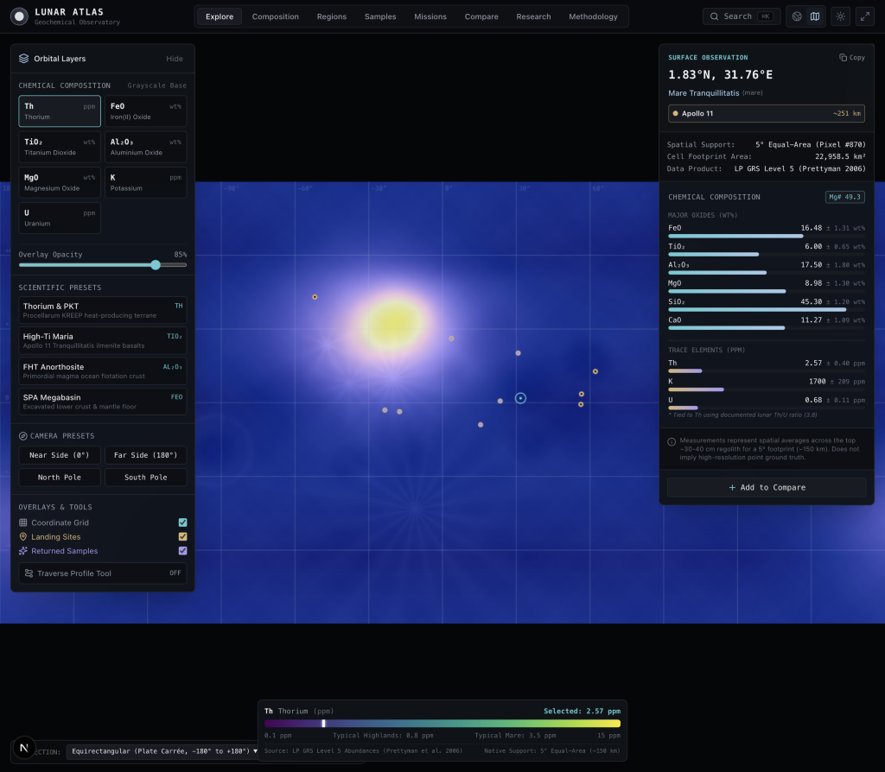
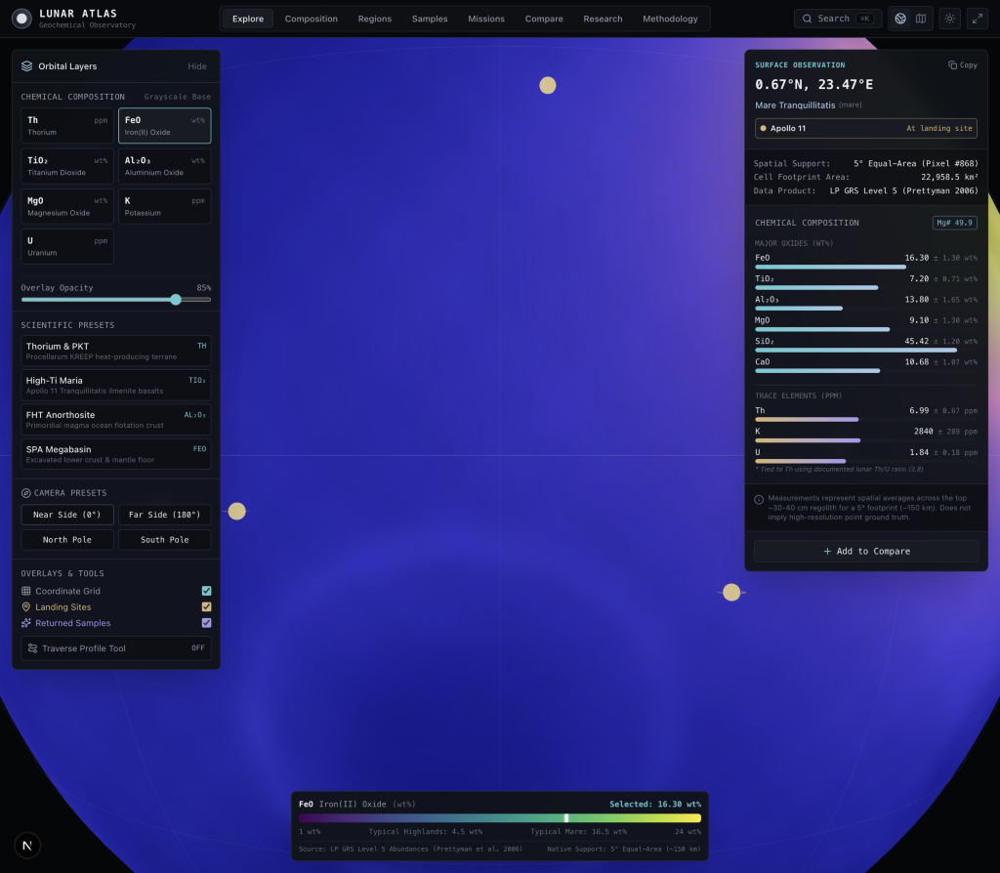
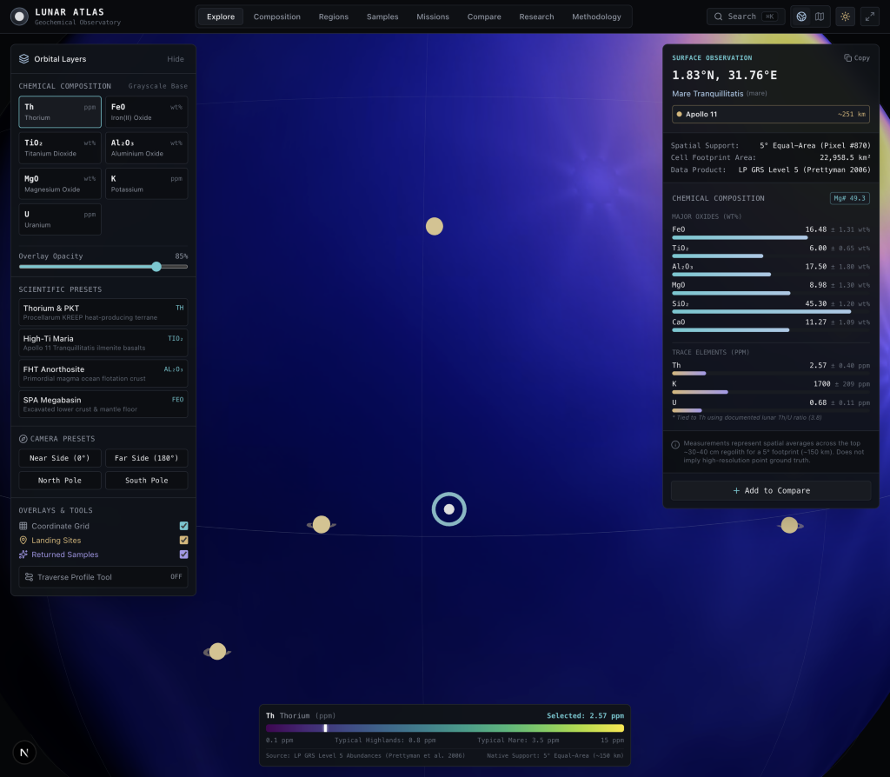
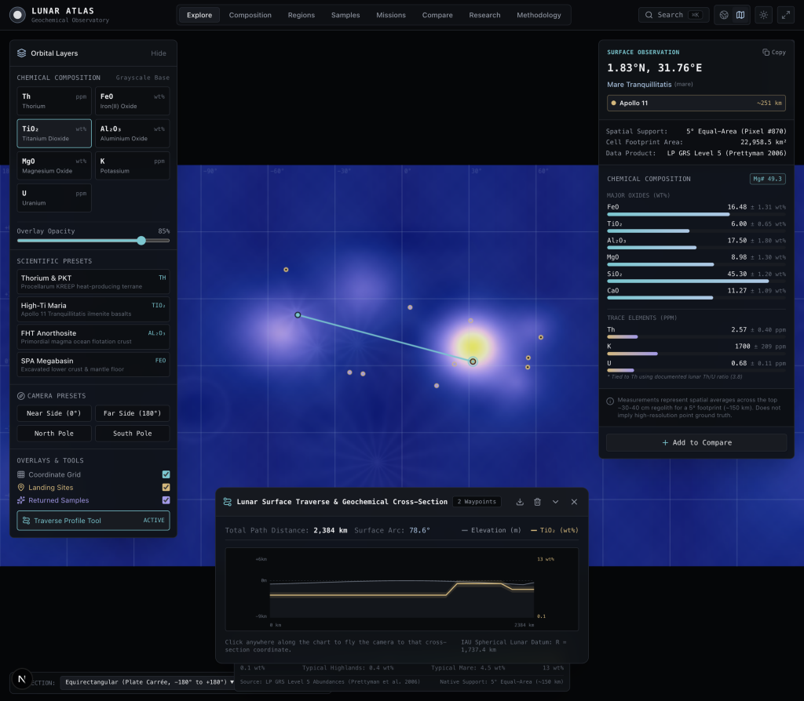
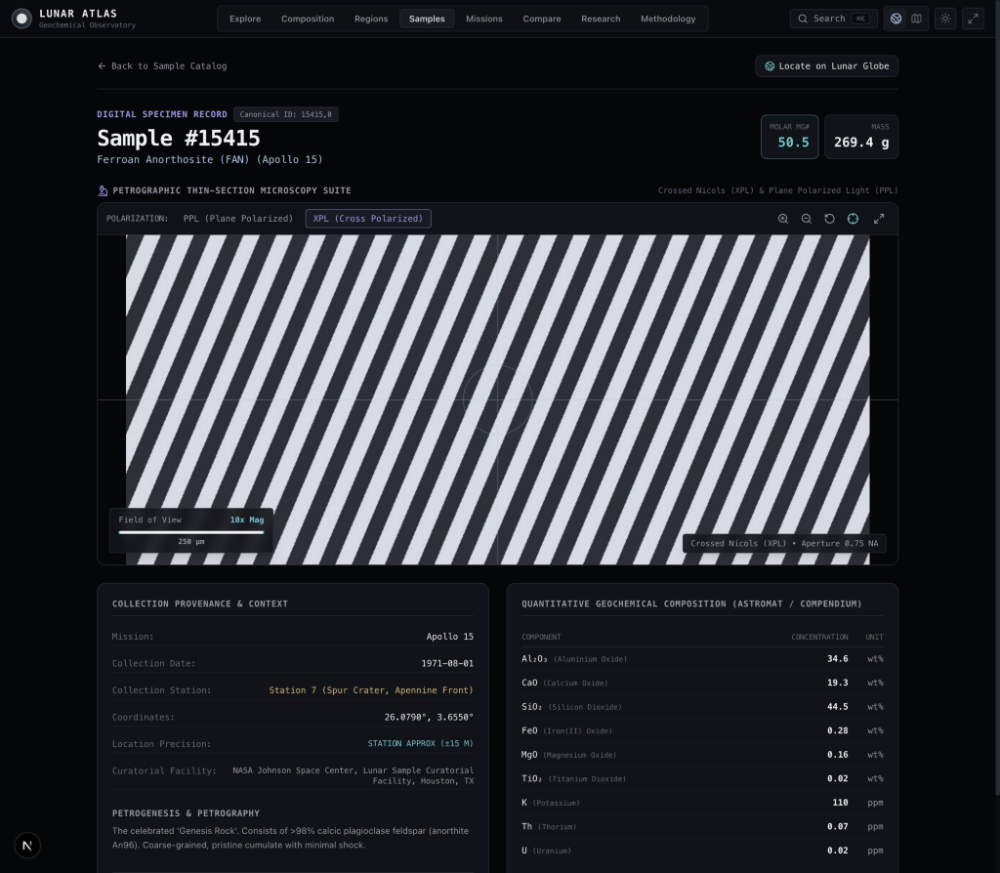
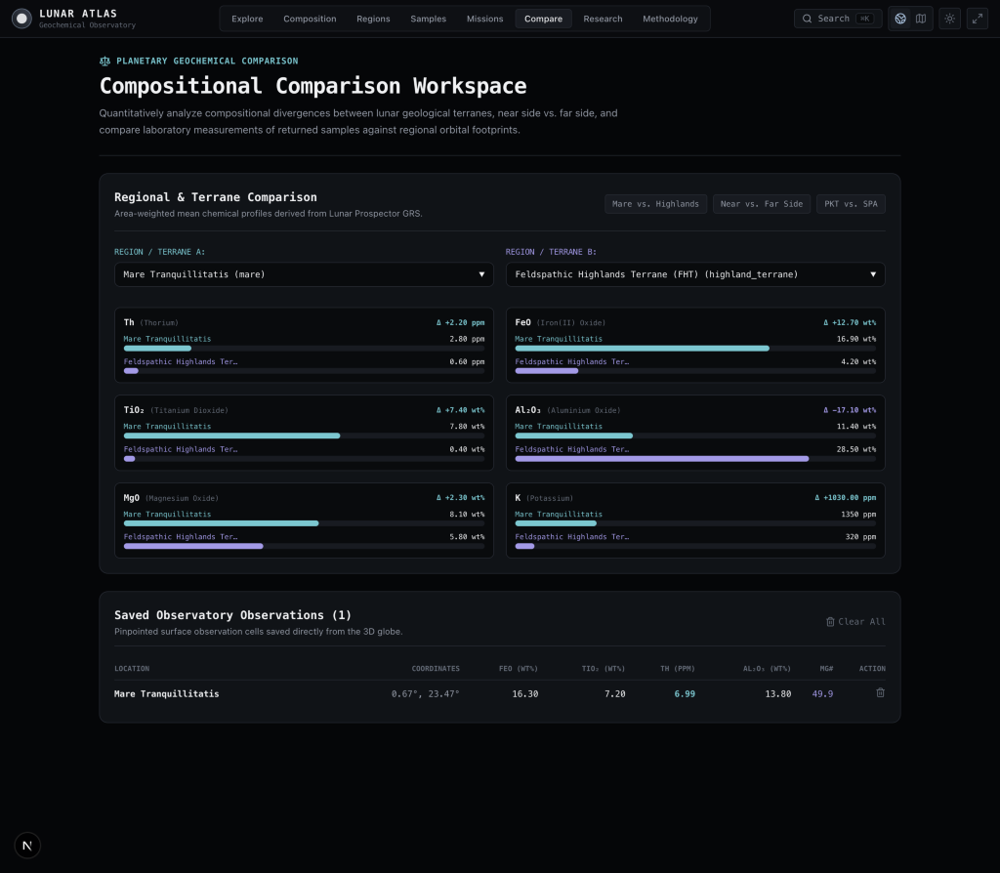
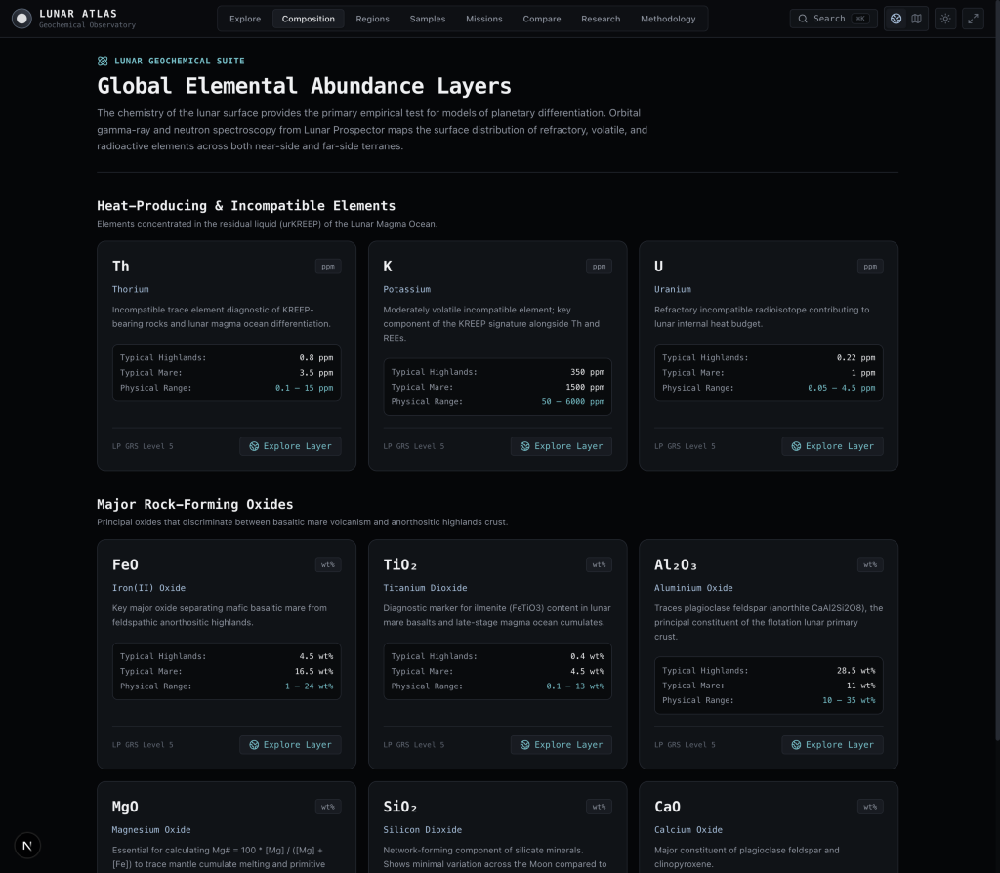

# Lunar Atlas — Lunar Geochemical Observatory

> **Explore the chemistry of another world.**
> Connect orbital remote sensing with laboratory geochemical measurements of returned lunar specimens.

[](https://github.com/ranajahanzaib/lunar-atlas/actions/workflows/ci.yml)
[](./LICENSE)



---

## 1. Scientific Overview & Problem

**What can the chemical composition of the lunar surface and returned specimens tell us about the Moon's formation, geological evolution, and internal differentiation?**

Planetary geochemists and planetary geologists have traditionally had to work across disconnected datasets: orbital gamma-ray/neutron spectrometers with large regional spatial integration footprints (~100–10,000 km²) and high-precision laboratory analyses of small returned hand specimens collected during Apollo, Luna, and Chang'e missions.

**Lunar Atlas** bridges this gap inside a unified, local-first interactive scientific observatory:

- **Orbital Remote Sensing**: Global elemental abundance maps from the **Lunar Prospector Gamma Ray Spectrometer (GRS)** (Prettyman et al. 2006) spanning 1,652 equal-area 5° observation cells across the entire lunar surface.
- **Returned Specimen Repository**: Authenticated geochemical laboratory analyses of returned lunar rocks and regolith from **Apollo 11, 12, 14, 15, 16, 17, Luna 16, 20, 24, and Chang'e 5**, cross-referenced against the NASA Lunar Sample Compendium and Astromat.
- **Digital Petrographic Microscopy**: High-resolution interactive virtual microscope supporting both **Cross-Polarized Light (XPL)** and **Plane-Polarized Light (PPL)** with calibrated physical scale bars (μm/mm).
- **Planetary Coordinate Reference Frame**: Explicit planetocentric East-positive coordinates $[-180^\circ, +180^\circ]$ with documented mean lunar radius ($R = 1,737.4\text{ km}$).

---

## 2. Visual Showcase Gallery

### Planetary Multi-Projection Atlas & 3D Navigable Globe

The observatory offers real-time switching between a 3D Three.js globe with relief-preserved chemical abundance shaders and a multi-projection 2D planar atlas (Equirectangular, Orthographic Near/Far Side, and Polar Stereographic).

|               3D Lunar Globe (Iron Oxide FeO)               |                        3D Globe with Solar Terminator Relief                         |
| :---------------------------------------------------------: | :----------------------------------------------------------------------------------: |
|  |  |

_Left: 3D Lunar Globe showing Iron(II) Oxide (FeO wt%) distribution across basaltic maria and feldspathic highlands with Apollo landing sites. Right: Authentic LROC WAC basemap under dynamic solar terminator illumination._

---

### Geodesic Traverse & Geochemical Cross-Section Profile Tool

Plan and measure great-circle paths across the lunar surface ($R = 1,737.4\text{ km}$). The engine interpolates topography and active elemental abundances along the traverse, rendering dual-axis cross-sections with $\pm 1\sigma$ uncertainty envelopes and exporting to standard GeoJSON.



_Interactive traverse across Mare Tranquillitatis and Oceanus Procellarum, displaying 2,384 km path distance, 78.6° surface arc, topography, and TiO₂ concentration._

---

### Digital Petrographic Thin-Section Microscopy Suite

Examine returned lunar specimens at microscopic resolution. Toggle between Parallel Polarized Light (PPL) and Crossed Nicols (XPL) with variable magnification, calibrated reticles, and quantitative oxide concentrations.



_Digital specimen record of Apollo 15 "Genesis Rock" (#15415) ferroan anorthosite (FAN) under Crossed Nicols (XPL) at 10× magnification._

---

### Compositional Comparison & Global Elemental Layers

Contrast major lunar terranes (Procellarum KREEP Terrane vs. South Pole-Aitken Basin vs. Feldspathic Highlands) and pin observations directly from the globe into persistent comparison records.

|                 Terrane Comparison Workspace                  |                         Global 9-Element Suite                         |
| :-----------------------------------------------------------: | :--------------------------------------------------------------------: |
|  |  |

_Left: Quantitative terrane differentials with saved observation pinboards. Right: Global catalog covering all 9 rock-forming oxides and incompatible trace elements._

---

## 3. Key Features

- **Interactive 3D Lunar Globe**: Built with Three.js and React Three Fiber. Features authentic grayscale LROC WAC planetary mosaic and multi-layer GLSL relief-preserved chemical abundance overlays.
- **Multi-Projection 2D Lunar Atlas**: Synchronized 2D planar map supporting Equirectangular (Plate Carrée), Orthographic (Near-side / Far-side centered), and Polar Stereographic (North / South Pole) projections.
- **Traverse & Geochemical Cross-Section Profile Tool**: Interactive geodesic wayfinding engine measuring exact lunar surface distances ($R = 1,737.4\text{ km}$), drawing dual-axis cross-sections of topographic elevation and elemental abundances with $\pm 1\sigma$ uncertainty envelopes, and exporting to GeoJSON.
- **Nine Global Elemental Overlays**:
  - **Iron Oxide (FeO)** & **Titanium Dioxide (TiO₂)**: Trace basaltic mare volcanism and ilmenite mantle cumulates.
  - **Aluminium Oxide (Al₂O₃)**: Traces the flotation anorthositic crust of the Lunar Magma Ocean.
  - **Thorium (Th)**, **Potassium (K)**, and **Uranium (U)**: Traces the heat-producing Procellarum KREEP Terrane (PKT), constrained by $U = Th / 3.8$.
  - **Magnesium Oxide (MgO)**: Traces primitive mantle cumulate melts (Molar Mg#).
  - **Silicon Dioxide (SiO₂)** & **Calcium Oxide (CaO)**.
- **Real-Time Region Inspector**: Raycast any point on the lunar globe to identify intersecting native orbital observation cells, surface area ($km^2$), elemental concentrations with $1\sigma$ uncertainties, and molar Mg#.
- **Compositional Comparison Workspace**: Directly contrast major terranes (e.g. Maria vs. Feldspathic Highlands, Near side vs. Far side, PKT vs. SPA) with grouped abundance distributions.
- **Persistent Local State**: Saved surface observation pins and preferences persist across navigation and browser sessions.
- **Global Command Palette**: Instant keyboard shortcut (`Cmd+K` or `Ctrl+K`) for rapid navigation across lunar features, samples, missions, and chemical layers.

---

## 4. Architecture & Monorepo Structure

```text
lunar-atlas/
├── apps/
│   └── web/                   # Next.js App Router Web Application
│       ├── app/               # Routes: /, /composition, /regions, /samples, /missions, /compare, /research, /methodology
│       ├── components/        # 3D Globe, 2D Atlas, Microscope, Layer Panel, Inspector
│       ├── lib/               # Data client & fast spatial intersection
│       ├── shaders/           # GLSL shaders for relief-preserved elemental overlays
│       ├── stores/            # Zustand state management with local persistence
│       └── public/data/       # Authoritative datasets, manifests, and textures
├── packages/
│   ├── lunar-geometry/        # Spherical trigonometry, distance, area, Mg#, covariance propagation
│   └── scientific-types/      # Authoritative TypeScript types for geochemistry & missions
├── pipelines/
│   ├── acquisition/           # Authoritative ingestion pipeline (Prettyman 2006, Astromat, Compendium)
│   └── geospatial/            # LROC basemap synthesis, elemental raster textures, and micrographs
├── data/                      # Processed datasets and manifests
├── docs/
│   └── screenshots/           # Authentic UI showcase captures
└── tests/                     # Python scientific tests & Vitest unit tests
```

---

## 5. Getting Started

### Prerequisites

- **Node.js** >= 20 (Node 22 recommended)
- **pnpm** >= 10
- **Python** >= 3.12 with [uv](https://docs.astral.sh/uv/)

### Installation

```bash
# Clone the repository
git clone https://github.com/ranajahanzaib/lunar-atlas.git
cd lunar-atlas

# Install JavaScript/TypeScript dependencies
pnpm install

# Install Python scientific pipeline dependencies
uv sync
```

### Running the Development Observatory

```bash
pnpm dev
```

Open [http://localhost:3000](http://localhost:3000) in your browser.

---

## 6. Verification & Testing

The repository maintains strict verification across both TypeScript unit tests and Python scientific validation suites:

```bash
# Run Vitest unit tests (spherical geometry, Mg#, data client, uranium constraints)
pnpm test

# Run Python scientific validation tests (PDS schemas, physical bounds, uranium constraints)
uv run pytest

# TypeScript typecheck across monorepo
pnpm typecheck

# Production build
pnpm build
```

---

## 7. Scientific Protocols & Constraints

1. **Planetary Coordinate Reference Frame**:
   - Strictly conforms to the IAU/IAG planetocentric, East-positive coordinate system $[-180^\circ, +180^\circ]$.
   - The mean volumetric radius of the Moon is $R = 1,737.4\text{ km}$ (`LUNAR_MEAN_RADIUS_KM`).
2. **Geochemical Abundances & Units**:
   - Major rock-forming oxides: FeO (wt%), TiO₂ (wt%), Al₂O₃ (wt%), MgO (wt%), SiO₂ (wt%), CaO (wt%).
   - Incompatible trace elements: Thorium (ppm), Potassium (ppm), Uranium (ppm).
   - In Lunar Prospector Level 5 products, uranium concentration is constrained to thorium by the documented lunar ratio: $U = Th / 3.8$.
   - Molar Magnesium Number (Mg#) is calculated using authentic molar masses:
     $$\text{Mg\#} = 100 \times \frac{[\text{MgO}] / 40.3044}{([\text{MgO}] / 40.3044) + ([\text{FeO}] / 71.8444)}$$
     assuming $\text{Fe}^{2+}$ dominance under highly reducing lunar oxygen fugacity.
3. **Sample Provenance & Disparity Rules**:
   - Unverified sample locations are strictly flagged as `unmapped` or `mission_only`.
   - Never conflate returned hand specimens with orbital pixels. Orbital gamma-ray footprints integrate over ~100–10,000 km² and the top ~30–40 cm regolith, whereas returned rocks represent small clasts subject to astronaut sampling bias.

---

## 8. Authoritative Citations

1. **Prettyman, T. H. et al. (2006)**. _Elemental concentrations on the Moon from Lunar Prospector gamma-ray spectrometry_. J. Geophys. Res., 111, E12007. [doi:10.1029/2005JE002656](https://doi.org/10.1029/2005JE002656)
2. **Jolliff, B. L. et al. (2000)**. _Major lunar crustal terranes: Surface expressions and crust-mantle origins_. J. Geophys. Res., 105(E2), 4197–4216. [doi:10.1029/1999JE001103](https://doi.org/10.1029/1999JE001103)
3. **Meyer, C. (2008)**. _The Lunar Sample Compendium_. NASA Johnson Space Center ARES.
4. **Archinal, B. A. et al. (2018)**. _Report of the IAU/IAG Working Group on Cartographic Coordinates and Rotational Elements: 2015_. Celest. Mech. Dyn. Astron., 130(3), 22.

---

## License & Custom Work

[](mailto:work@withrana.com) [](https://www.linkedin.com/in/workwithrana)
[](https://www.upwork.com/freelancers/~01bbcf6edb91a8df5f)
[](https://contra.com/ranajahanzaib/)

**License:** MIT, see [LICENSE](LICENSE). Free for personal and commercial use.

**Author:** Rana Jahanzaib

**Need this built for your stack?** Email me what you're working on: work@withrana.com
